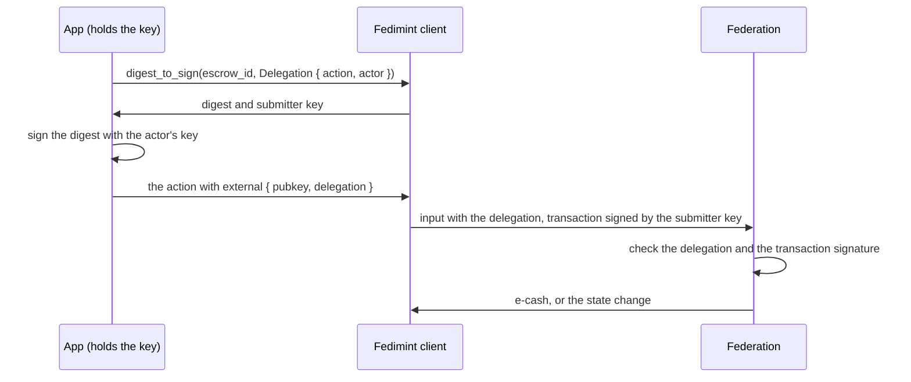
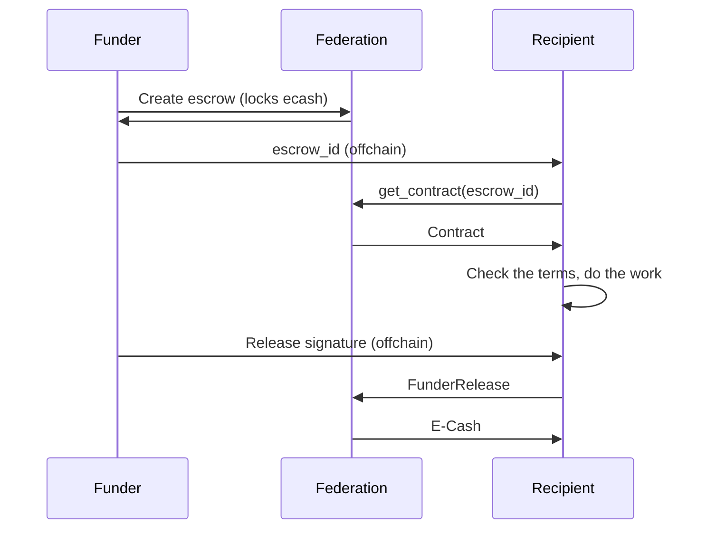
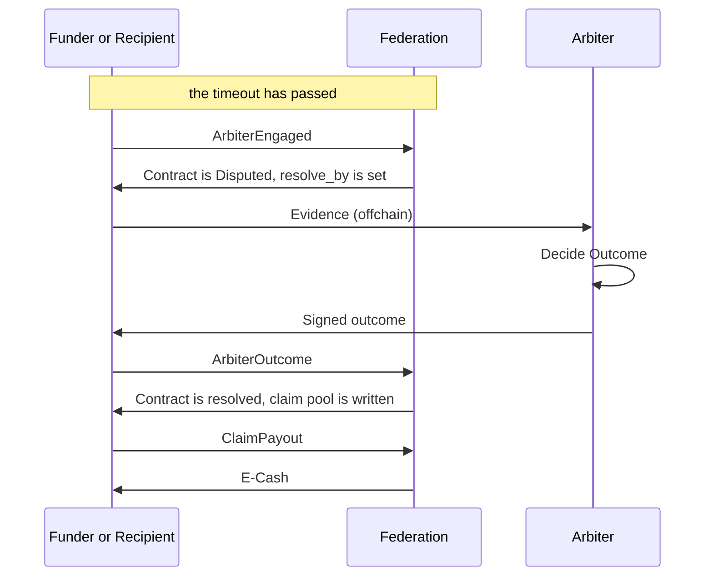
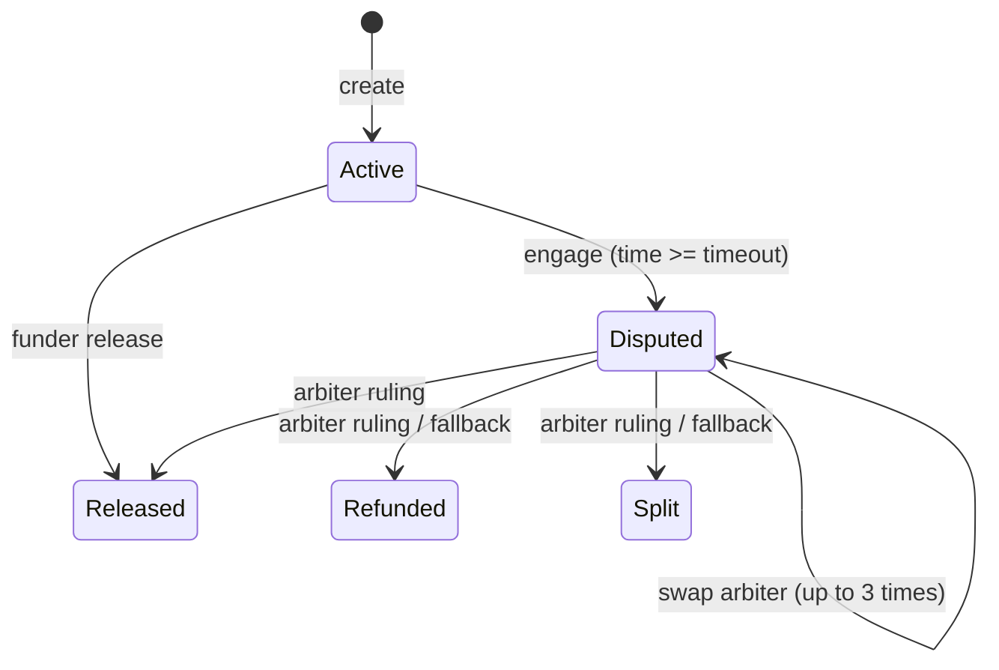
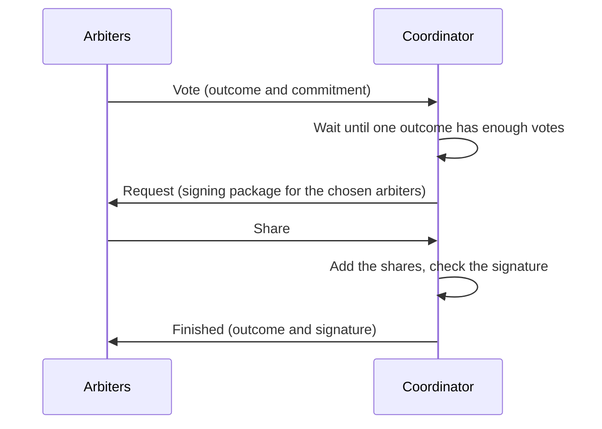

# Escrow Module
The escrow module lets two people trade with ecash when they don't trust each other. The funder locks ecash in a contract, the recipient does their part, and the funder signs a release so the recipient can claim the ecash. If they cancel instead, the recipient can sign a refund so the funder gets the ecash back. If they disagree, an arbiter decides.The federation only enforces the contract rules and verify signatures. It doesn't know who the people are and it can't see what the deal is about.

The module can't know if goods were delivered or a service was done. It only enforces what the contract and the signatures say.

### Roles
- Funder - locks the ecash and signs the release when they are happy.
- Recipient - gets the ecash. Does their part of the deal outside of the federation.
- Arbiter - decides when the two disagree. It can be one key or a group of arbiters, the federation sees one public key either way (see [Arbiter consortium](#arbiter-consortium)).
- Fee keys - the keys that share the arbiter fee.

### The contract
`EscrowContract` is created by the funder and stored by the federation under its `escrow_id`.

- `escrow_id` - `sha256("fedimint_escrow_id_v1" || contract_hash || random nonce)`.
- `funder_key`, `recipient_key`, `arbiter_key` - schnorr public keys. They are compared by their x-only form, because that is all a schnorr signature uses.
- `arbiter_fee_key` - list of keys that share the arbiter fee, at most 16.
- `amount` - the locked amount.
- `arbiter_fee` - the part of `amount` that goes to the fee keys if the arbiter rules.
- `timeout` - unix time. Before it only the funder's release works, after it a party can bring in the arbiter.
- `resolution_period` - seconds the arbiter has to rule after it was brought in. At least 10 minutes.
- `default_fallback` - what happens if the arbiter is silent: `Refund`, `Split { funder_split_bps, recipient_split_bps }` or `SwapArbiter { successors }`  Each successor contains an arbiter_key, arbiter_fee_key and arbiter_fee. A contract can configure up to 3 successor arbiters.
- `federation_id` and `contract_hash`.
- `status` - `Active`, `Disputed { resolve_by, swaps_used }`, `Released(ResolutionRecord)`, `Refunded(ResolutionRecord)` or `Split(ResolutionRecord)`. Terminal statuses contain metadata describing how and when the contract was resolved.

[compute_contract_hash](../modules/fedimint-escrow-common/src/lib.rs) hashes funder, recipient, arbiter, arbiter fee, amount, timeout, federation id, resolution period, fee keys and the default fallback. It does not cover `status` or `escrow_id`.

Splits are in basis points (parts per 10,000) and both sides have to add up to 10,000.

### Federation time
Timeouts need a clock that every guardian agrees on. Each guardian votes with its own clock, rounded down to a full minute (`EscrowConsensusItem::UnixTimeVote`). A vote can only go up. The time the module uses is the highest time that a threshold of guardians has reached. It is 0 until the first votes are in.

- [Escrow::consensus_unix_time](../modules/fedimint-escrow-server/src/lib.rs) - computes the federation time from the votes.

This means time moves in steps of one minute and a timeout is never exact. Clients read the time with the `consensus_unix_time` endpoint, so the checks a client does before it submits can be a bit off. The federation always decides with its own time.

### Creating an escrow - User Client
- [EscrowClientModule::create_escrow](../modules/fedimint-escrow-client/src/lib.rs) - sets the `timeout` to the federation time plus the requested duration, computes the contract hash, picks a `escrow_id`, validates the contract and submits a transaction with the contract as an output. The output takes `amount` from the funder's ecash.
- The funder gives the `escrow_id` to the recipient outside of the federation. Before doing any work, the recipient checks every term: the keys, amount, arbiter_fee, arbiter_fee_key, timeout, resolution_period and default_fallback. The funder chooses all of them and the federation can’t know what was agreed.
- `funder_key` is optional. If it is given, that key is the funder. It doesn't have to sign anything to create the escrow, the ecash comes from the client that submits.

### Creating an escrow - Federation
- [Escrow::process_output](../modules/fedimint-escrow-server/src/lib.rs) - validates the contract with [validate_contract_fields](../modules/fedimint-escrow-common/src/lib.rs), recomputes the contract hash, rejects an `escrow_id` that already exists and stores the contract.

A contract is rejected if:
- the amount is zero or the arbiter fee is not smaller than the amount
- the timeout is not in the future, or the resolution period is shorter than 10 minutes
- a split doesn't add up to 10,000
- funder, recipient, arbiter and fee keys are not all different from each other (also counting the keys in `SwapArbiter`)
- Each successor's arbiter fee must be smaller than the escrow amount.
- A successor with a non-zero arbiter fee must have at least one fee key. Each successor can have at most 16 fee keys (the same limit as the original arbiter)
- timeout plus one resolution period for the original arbiter and each successor must fit in 64 bits”

### Resolving
After creation everything is an `EscrowInput { escrow_id, resolution, delegation(Optional) }`.

| Resolution | Works when | Result | Signs the tx |
|---|---|---|---|
| `FunderRelease` | contract is `Active`, the funder signed the Release message | `Released`, recipient gets the full amount in the same tx | recipient |
| `RecipientRefund` | contract is `Active`, the recipient signed the Refund message | `Refunded`, funder gets the full amount in the same tx | funder |
| `ArbiterEngaged` | `Active`, time >= `timeout`, a party signed the engage message | `Disputed { resolve_by = now + resolution_period }` | the party |
| `ArbiterOutcome` | `Disputed`, time <= `resolve_by`, the current arbiter signed the outcome | `Released`, `Refunded` or `Split`, a claim pool is written | the submitter |
| `ResolveFallbackPolicy` | `Disputed`, time > `resolve_by`, claimer is a party | switches to the next configured successor arbiter, or applies the final fallback (Refund) when all successors have been used | the claimer |
| `ClaimPayout` | the claim pool has an entry for the key | the entry is paid and removed | the key in the pool |


- The funder release and the recipient refund are not limited by time. They work before and after the timeout until someone brings in the arbiter. After that they are rejected, so a signature that is still around can’t beat the arbiter.
- Only the recipient can submit a release and only the funder can submit a refund, because the transaction has to be signed with the key that receives the ecash. The client’s resolve_escrow picks the right one from the caller’s role.
- Both signatures are bearer authorisations, valid until the contract leaves Active. A recipient should submit a release as soon as they receive it, and never rely on it after the timeout, because the funder can then bring in the arbiter and invalidate it. A recipient should only sign a refund when they really want to cancel.
- An arbiter ruling can be submitted by any key of the contract: funder, recipient, arbiter, a fee key or the keys of the swap arbiter. The submitter only signs the transaction. What matters is the arbiter signature inside the input.
- At exactly `resolve_by` the arbiter can still rule and the fallback is not available yet.
- The `fallback` field in `ResolveFallbackPolicy` is not looked at by the federation. It always uses `default_fallback` from the contract.

### Delegated authorization
Every action in a contract is done by a key: the recipient collects a release, the funder collects a refund, a party brings in the arbiter, and so on. Normally that key also signs the Fedimint transaction, so it has to be a key the client can sign with.

A delegation lets the key stay outside the client. The key signs one small message instead of the transaction. The message says "this key lets that submitter key do this action on this escrow". The client signs the transaction with the submitter key, which it derives itself, and the federation checks both. Use it when the keys live in an app and the client can be thrown away, for example a browser client whose storage may get lost.

You only need this for keys the client doesn't hold. Keys derived by the client keep working without it. Think of a delegation as a permission slip. Only a signature goes to the client, the private key stays in the app. So the client doesn't have to be the one that created the escrow. A new client, set up from nothing, can release, refund, engage, submit a ruling, trigger the fallback and claim.

The submitter is named in the message because a release, a refund and a claim pay whoever sends the transaction. Without it, anyone who saw the delegation could send the same action with their own outputs.

#### What the app signs
The delegation is always signed by the key that does the action. The other signatures are the same ones as without a delegation: the funder's release, the recipient's refund, the engage signature of a party and the ruling of the arbiter.

| What you want to do | What the app signs | Where it goes |
|---|---|---|
| Recipient collects a release | the funder signs `Resolution(Release)`, the recipient key signs `Delegation(FunderRelease, recipient)` | `signature`, `external.delegation` of `resolve_escrow` |
| Funder collects a refund | the recipient signs `Resolution(Refund)`, the funder key signs `Delegation(RecipientRefund, funder)` | `signature`, `external.delegation` of `resolve_escrow` |
| A party brings in the arbiter | the party signs `Engage` and `Delegation(ArbiterEngaged, party)` | `external.engage_message`, `external.delegation` of `engage_arbiter` |
| Someone submits the arbiter's ruling | the arbiter (or the consortium) signs `Resolution(outcome)`, the submitting key signs `Delegation(ArbiterOutcome, key)` | `arbiter_signature`, `external.delegation` of `submit_arbiter_decision` |
| A party triggers the fallback | the party signs `Delegation(ResolveFallbackPolicy, party)` | `external.delegation` of `trigger_fallback` |
| A key claims its payout | the key signs `Delegation(ClaimPayout, key)` | `external.delegation` of `claim_payout` |
| Create an escrow | nothing | pass the funder's public key to `create_escrow` |

Each digest comes from [digest_to_sign](../modules/fedimint-escrow-client/src/lib.rs). It takes the escrow id and what you want to sign (`Engage`, `Resolution(outcome)` or `Delegation { action, actor }`) and returns a 32 byte digest. Sign it as it is with BIP-340, without hashing it again. For a delegation it also returns the submitter key, which is the key this client will use for the transaction.



#### Which client submits
- The submitter key is derived from the module root secret of the client, for each escrow and action. So `digest_to_sign` and the action have to go to the same client. If the client is replaced in between, ask for the digest again and sign again.
- A delegation is good for one escrow, one action, one actor and one submitter. Somebody who sees it can't use it, because the transaction also needs the submitter key and that never leaves the client.
- The ecash of a release, a refund or a claim goes to the client that submits, not to the key that acted. That client has to keep it, or the app has to move it out. The key in the contract only decides who is allowed.
- A client only tracks the operations it submitted. A new client can't follow the `operation_id` of another one. To see how things stand use `get_contract` and `get_claim_pool`.

Example, the recipient collects a release with a new client:
1. The funder's app asks `digest_to_sign` for `Resolution(Release)` and signs it. This is the release signature.
2. The recipient's app asks `digest_to_sign` for `Delegation { FunderRelease, recipient key }` and gets the digest and the submitter key.
3. The recipient's app signs the digest with the recipient key.
4. The recipient's app calls `resolve_escrow` with the release signature and `external { pubkey, delegation }`.
5. The ecash arrives in that client.

### ResolutionRecord
When a contract reaches a terminal state, its status stores a ResolutionRecord:

```
pub struct ResolutionRecord {
    pub by: ResolvedBy,
    pub at: u64,
}
```

- by - identifies how the contract was resolved. FunderRelease, RecipientRefund, ArbiterRuling { arbiter } or Fallback { silent_arbiter }. arbiter is the key that signed the ruling, so it can be the original arbiter or a swap arbiter. For a fallback, silent_arbiter is the arbiter that was active and did not rule.
- at - Unix timestamp (in seconds) when the contract was resolved, using federation consensus time.

### Releasing - the happy path


- [EscrowClientModule::resolve_escrow](../modules/fedimint-escrow-client/src/lib.rs) - recipient submits the funder’s release, or the funder submits the recipient’s refund.
- [Escrow::handle_resolution](../modules/fedimint-escrow-server/src/lib.rs) - checks the release, marks the contract `Released` and returns the full `amount` as the input amount, which the client turns into ecash. No arbiter fee is taken, the arbiter did no work.

### Disputes


- [EscrowClientModule::engage_arbiter](../modules/fedimint-escrow-client/src/lib.rs) - a party signs the engage message and submits it. No funds move.
- [EscrowClientModule::submit_arbiter_decision](../modules/fedimint-escrow-client/src/lib.rs) - submits the signed outcome of the arbiter. The client picks one of its own keys that is in the contract to sign the transaction.
- [EscrowClientModule::trigger_fallback](../modules/fedimint-escrow-client/src/lib.rs) - a party asks for the fallback after `resolve_by`.

If the arbiter stays silent past `resolve_by`, its signature is not accepted anymore and a party can trigger the fallback. `Refund` and `Split` resolve the contract with no arbiter fee, since nobody did any work.

With SwapArbiter, each fallback trigger advances the contract to the next configured successor arbiter without paying anyone(upto 3 times). The contract increments swaps_used and sets a new resolve_by based on the current federation time plus resolution_period.

The successor at the current position becomes the active arbiter. Its arbiter_key, arbiter_fee_key and arbiter_fee replace those of the previous arbiter for resolution purposes. A ruling signed by a previous arbiter is rejected with InvalidSignature.

### Claim pool
A ruling or a fallback doesn't pay anyone in the same transaction. It writes a claim pool for the `escrow_id`, a list of `(key, amount)` entries:
- `Release` - the recipient gets `amount - arbiter_fee`.
- `Refund` - the funder gets `amount - arbiter_fee`.
- `Split` - the funder and the recipient split `amount - arbiter_fee`. The funder share is rounded down in msats and the recipient gets the rest.
- The fee is split equally between the fee keys.
- A fallback has no fee, the whole amount goes to the parties.

The entries always add up to `amount` and entries with zero are dropped. Every key claims its own entry with `ClaimPayout`, in any order, and when the last entry is gone the pool is deleted. A funder release and a recipient refund are the only cases that pay directly and have no pool. Although a claim pool never expires, claimer can claim their sats as they want.

- [EscrowClientModule::claim_payout](../modules/fedimint-escrow-client/src/lib.rs) - claims the entry of the first client key that is in the pool, or the entry of the external key if one is given.
- [Escrow::handle_claim](../modules/fedimint-escrow-server/src/lib.rs) - removes the entry (keys are compared x-only) and returns its amount.
- [Escrow::audit](../modules/fedimint-escrow-server/src/lib.rs) - an `Active` or `Disputed` contract counts its `amount` as a liability. A resolved contract counts nothing, the pool counts whatever is not claimed yet.

### States


`Released`, `Refunded` and `Split` are final. The money in them is only paid once the claim pool is claimed, except for the funder release.

### All rules in one place
The checks for a resolution (state, time, who is allowed, signatures) are in [check_resolution](../modules/fedimint-escrow-common/src/rules.rs). It is a pure function: it gets the contract, the resolution and the time, and it returns an `AcceptedResolution` with three things:
- `transition` - the `EscrowTransition` to apply
- `settlement` - nothing to pay, pay the recipient now, or write these claims
- `input_key` - the key that has to sign the transaction input

It never touches the database. The federation calls it in `handle_resolution` and then applies the transition with [EscrowContract::transition](../modules/fedimint-escrow-common/src/lib.rs), which is the only place that changes `status`. The client calls the same function before it submits, so a client can't disagree with the federation about the rules (it can still be wrong about the time). `ClaimPayout` is not part of this, it goes through `ClaimPool::take_claim`.

### Signed messages
Every signature is a BIP-340 schnorr signature over a 32 byte sha256 digest. Sign the digest as it is, without hashing it again. The digest is the sha256 of the bytes below, put one after the other with no length prefixes, see [compute_escrow_message](../modules/fedimint-escrow-common/src/lib.rs).

How the parts are written:
- ids and hashes (`federation id`, `escrow id`, `contract hash`) are their raw 32 bytes
- keys are 33 byte compressed keys, the same bytes as in the contract. The parity prefix is part of the digest, so use the same bytes everywhere.
- numbers are little endian

**Resolution message** - signed by the funder with `Release`, by the recipient with `Refund`, and by the arbiter with the outcome it chose:

| part | bytes |
|---|---|
| tag `fedimint_escrow_resolution_message_v1` | 37 |
| federation id | 32 |
| escrow id | 32 |
| outcome | 1 or 5 |
| contract hash | 32 |

The outcome is `00` for `Release`, `01` for `Refund`, and `02` followed by `funder_split_bps` and `recipient_split_bps` as two u16 for `Split` (5 bytes).

**Engage message** - signed by the funder or the recipient to bring in the arbiter:

| part | bytes |
|---|---|
| tag `fedimint_escrow_engage_message_v1` | 33 |
| federation id | 32 |
| escrow id | 32 |
| contract hash | 32 |

**Delegation message** - signed by the actor, see [Delegated authorization](#delegated-authorization):

| part | bytes |
|---|---|
| tag `fedimint_escrow_delegation_message_v1` | 37 |
| federation id | 32 |
| escrow id | 32 |
| contract hash | 32 |
| actor | 33 |
| action | 1 |
| submitter | 33 |

The action is one byte: `FunderRelease` 0, `RecipientRefund` 1, `ArbiterEngaged` 2, `ArbiterOutcome` 3, `ClaimPayout` 4, `ResolveFallbackPolicy` 5.

#### Check a digest before you sign it
An app doesn't have to sign what the client hands it. It can work out every digest itself and refuse to sign if it doesn't match. A funder's release pays out, so this is the one to check.
1. Read the contract with `get_contract` and check every term against what was agreed: the keys, `amount`, `arbiter_fee`, `arbiter_fee_key`, `timeout`, `resolution_period` and `default_fallback`.
2. Take the federation id from your own setup, not from the client. Take `escrow_id` and `contract_hash` from the contract. Check that `contract_hash` is the hash of those terms, see [compute_contract_hash](../modules/fedimint-escrow-common/src/lib.rs).
3. Build the preimage above for what you want to sign and hash it.
4. Compare it with the digest of `digest_to_sign`. Sign only if they are the same.

The submitter in a delegation is the one part an app can't check. It is the key the client signs the transaction with, and the release, the refund and the claim pay whoever holds it. Only ask for a delegation from a client you run yourself.

#### Test vectors
Inputs: federation id is `11` repeated 32 times, escrow id is `22` repeated 32 times, contract hash is `33` repeated 32 times, actor is `02c6047f9441ed7d6d3045406e95c07cd85c778e4b8cef3ca7abac09b95c709ee5` (the key of secret 2) and submitter is `02f9308a019258c31049344f85f89d5229b531c845836f99b08601f113bce036f9` (the key of secret 3).

| message | preimage length | digest |
|---|---|---|
| engage | 129 | `55a48e0860db686e536d446f4f4fadb8a20e6bcc92065f3bb2540e80db8f2e4e` |
| resolution, `Release` | 134 | `5f71112ab659a6212f33ac565ee2f97532ad0f5c0142268e30b33f997ce3e2e2` |
| resolution, `Refund` | 134 | `d20a3c04e9631df3ce93f357b9e99dc3d78216301f7e14f76e12ec505d29c4a8` |
| resolution, `Split` 2500 / 7500 | 138 | `a35db741d9b13daedf71d1e2eb1d738d3400472d7501b3dbfe408f49e17d4910` |
| delegation, `FunderRelease` | 200 | `9ba97dba337c248d000cb1da224c685dd73d961d540be70dbc32a1f30af9f65b` |
| delegation, `ClaimPayout` | 200 | `d25f411da221ad65be13743c31e2090c15448f72b5fe81b272b6e7746f54e529` |

### Client keys
The client derives its keys from the module root secret:
- child 0, `escrow_key` - the key a user has as funder, recipient or disputant. It signs messages and transaction inputs.
- child 1, `arbiter_fee_key` - the key used to receive and claim arbiter fees. It can also submit rulings.
- child 3, iroh key - the identity used for the arbiter consortium network. Child 2 is not used.
- child 4, DkgStateKey - to encrypt and decrypt the client side dkg state and packages.
- child 5, SubmitterKey - only used for delegated actions, see [Delegated authorization](#delegated-authorization). It is derived again for every escrow and action, so nothing has to be stored.

These keys are only the default. An app that has its own keys (for example keys derived from a nostr identity) doesn't have to use them. It passes any key to `create_escrow` and uses a delegation for everything after that. Then the client holds nothing the app can't get back.

Use a new key for every escrow. The federation keeps a list of the contracts of every key (`list_contract_by_key`) and `get_contract` works for anybody who knows the `escrow_id`, so a key that is used twice links the two escrows. An app that finds its escrows some other way doesn't need `list_contract_by_key`.

Keys are compared x-only, so a key that only has an x coordinate (nostr) can be given with a `02` prefix. Use the same bytes everywhere, because the contract hash and the delegation digest cover all 33 bytes.

The public keys are available with the `get_client_escrow_pubkey` and `get_arbiter_fee_pubkey` client calls. [EscrowClientModule::list_contracts](../modules/fedimint-escrow-client/src/lib.rs) lists the contracts that contain one key: the escrow key by default, or the key you pass (pass the arbiter fee key to list the contracts where client are a fee key). Results are ordered by escrow_id. To page, pass limit and the last escrow_id of the previous page as last_seen.

### Arbiter consortium
The federation checks one signature against `arbiter_key`. That key can belong to a group of arbiters who made it together with FROST, then any `t` of the `n` arbiters can sign and nobody ever holds the whole private key. The federation can't tell the difference. The code is in [frost](../modules/fedimint-escrow-client/src/frost/).

A group has 4 to 16 arbiters and needs `n - f` of them to sign, where `f = (n - 1) / 3`:

| arbiters | needed to sign |
|---|---|
| 4 | 3 |
| 5 | 4 |
| 7 | 5 |
| 10 | 7 |

The funder puts the group key in the contract as `arbiter_key` and the fee key of every arbiter in `arbiter_fee_key`. Each arbiter then claims its own share of the fee. Nobody holds the full private key of the arbiter_key, so the signed ruling is submitted by a party or by a fee key holder.

#### Setting up the key (DKG)
- [FrostDkgSessionRecord](../modules/fedimint-escrow-client/src/frost/session.rs) - the group and the saved progress of the DKG. The `session_id` is a hash of the federation id and the sorted arbiter ids, so every arbiter gets the same one. An arbiter id (`FrostParticipant`) is derived from its `escrow_key`.
- [DkgRunner](../modules/fedimint-escrow-client/src/frost/dkg.rs) - the DKG steps and the messages to the other arbiters.
- [FrostDkgSessionRecord::run](../modules/fedimint-escrow-client/src/frost/session.rs) - runs the DKG from the last saved step:

```
Created -> Round1Started -> Round1Complete -> Round2Complete -> Confirming -> Finalized
```

1. Every arbiter makes a secret polynomial and sends the public part to everyone (round 1).
2. Every arbiter sends a secret share to each other arbiter, one by one (round 2).
3. Every arbiter checks the shares it got and computes its key share and the group key.
4. `Confirming`: the arbiters send each other a digest of the group key and all verifying shares. The key is only final when everybody has the same digest, otherwise the DKG is dropped. This stops one arbiter from giving different arbiters different keys.

Every step is saved in the client database, so a restart continues where it was. A step that failed because of the network is tried again up to 3 times. Anything else (bad data, wrong session) throws the saved progress away. [FrostDkgSessionRecord::reset](../modules/fedimint-escrow-client/src/frost/session.rs) clears an unfinished DKG but refuses to touch a finished key.

[consortium_pubkey](../modules/fedimint-escrow-client/src/frost/session.rs) turns the result into the public key that goes into the contract.

#### Signing a ruling
[frost_sign.rs](../modules/fedimint-escrow-client/src/frost/frost_sign.rs) does the signing. Every arbiter works out the message itself from the contract, so a coordinator can't ask for a signature on something else.



- [SigningMux](../modules/fedimint-escrow-client/src/frost/frost_sign.rs) - the only reader of the transport. It sorts incoming messages by escrow and drops messages from non-members, oversized ones and ones that can't be parsed.
- [sign_as_signer](../modules/fedimint-escrow-client/src/frost/frost_sign.rs) - votes, and signs only if the coordinator asks for exactly the message of the outcome it voted for.
- [sign_as_coordinator](../modules/fedimint-escrow-client/src/frost/frost_sign.rs) - takes the outcome that got enough votes, asks those arbiters to sign and adds the shares. Before it announces anything it checks the result as a normal BIP340 signature against the group key, which is what the federation will do.
- [sign_with_failover](../modules/fedimint-escrow-client/src/frost/frost_sign.rs) - every arbiter calls this with the outcome it chose. Time is cut into slots and the coordinator of a slot comes from the escrow id and the slot number, so everybody agrees on it without talking. If a slot fails (for example the coordinator is offline) the next slot has another coordinator. It must finish before the contract's `resolve_by`.

The arbiters have to finish in time. If no ruling reaches the federation before `resolve_by`, the fallback decides.

#### Transport
The arbiters talk through a transport ([transport](../modules/fedimint-escrow-client/src/frost/transport/)). It has two parts, one for the DKG rounds and one for the signing messages.
- Iroh - the real one. Arbiters connect to each other with iroh, a connection is tied to the iroh node id of the arbiter, and every message carries the session id. Messages from unknown nodes or other sessions are dropped.
- File - writes files in a temp directory. For testing purpose only.

### API
The server has four public endpoints. They are listed in [api.md](./api.md#escrow-module-api-endpoints).
- `get_contract` - a contract by `escrow_id`
- `get_claim_amount` - the claim pool of an escrow
- `list_contract_by_key` - the contracts that have a key in them
- `consensus_unix_time` - the federation time
